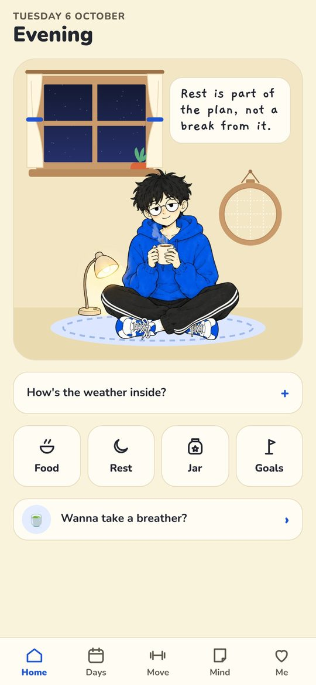
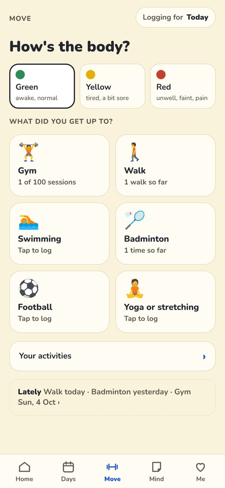
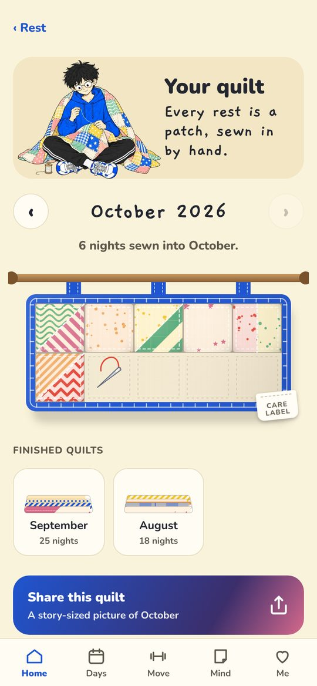
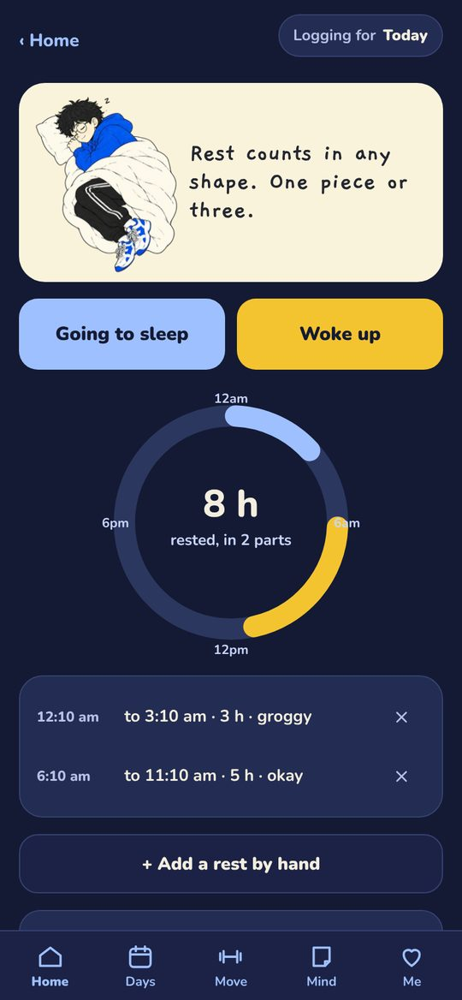

# Prequel

**The behind-the-scenes of everything you're becoming.**

Prequel is a gentle, private lifestyle companion for your phone. You log the everyday things: how you moved, what you ate, how you slept, the weather inside your head, and the small wins. Over time they become a night sky of stars, a hand-sewn quilt for every month, a jar of paper stars, story-sized share cards and tidy PDF reports.

It has no streaks, no scores and no zeros. Everything stays on your phone.

**[Open Prequel →](https://phavan1.github.io/prequel/)**

<p align="center">
  
  
  
  
</p>
<p align="center"><sub>Screenshots use made-up sample data.</sub></p>

---

## Features

**Move**
- A hub for every kind of moving: gym, walks, runs, cycling, swimming, badminton, football, cricket, tennis, kickboxing, MMA, yoga, dance, hiking, home workouts, or anything of your own.
- Each activity logs what matters for it, like games played, goals, rounds, laps or distance, plus a "highlight of the day". Everything is optional.
- Log one afterwards, or start a timer that keeps running even when the app is closed.
- A full gym logger: playbook workouts, a quick session, real exercise order, weights that can be "Not noted" or "Body weight", and sessions you can copy into any app.
- Milestones you choose for yourself (sessions, hours, km, goals…), instead of fixed targets.
- "How's the body?" (Green, Yellow or Red) shapes the suggestions, and gently suggests Yellow after a rough night.

**Food**
- Search about 9,000 foods, including around 1,000 Indian recipes, with friendly spelling.
- Your usual foods, your own meals and recipes, packet labels in kJ or Cal, and daily totals of 12 nutrients.
- A weekly or monthly food report as a PDF, with gentle ideas rather than rules.

**Rest**
- Going to sleep and Woke up, split nights and naps, and six ways to say how you woke up.
- An "Awake for a bit" card for the middle of the night, with Breathe with me, Put it down for the morning, and an optional "What woke you?".
- A monthly quilt, with one patch per night. Its colour shows how long you slept, and its pattern shows how you felt.
- A sleep diary PDF for your doctor: at a glance, week by week, hours each day, a sleep chart, every rest, and your own notes.

**On repeat**
- The song you can't stop playing, kept one era at a time as a cassette tape, with the era's name and the line that gets you.
- Find songs with their covers, press play on the tape for a 30-second preview, or listen in full in your own music app.
- A shelf of monthly mixtapes, a soundtrack for every month, and a "My year in songs" share card.

**Mind, wins and more**
- Notes that come back when you want them, lanterns you can let go (and call back), and letters to your future self.
- A jar of paper stars for small wins, with a proper celebration when a jar fills.
- A night sky where everything you log becomes a star.
- Goals that only count up, and an optional, private cycle tracker.
- Share cards for your sky, milestones, month and quilt, made on the phone.
- Light, cosy dark, or match the phone.

## Principles

- **Kind by design.** No streaks, no grades, no "perfect days" and no zeros on screen. Counts only go up. A hard day is a *soft day*.
- **Private.** No accounts, no servers, no analytics. Your data lives on your phone and leaves it only when you save a backup or share something yourself. The only outside service is Apple's public music search, which is used only when you look up a song, and receives only the words you typed.
- **Offline first.** Once opened, everything works without a connection, including food search, PDFs and share cards. Only finding a new song and playing its preview need the internet.
- **Accessible.** Colour is never the only signal, dates are written in words, and motion respects "reduce motion".

## Install

Prequel is a Progressive Web App, so there's nothing to download from a store.

- **iPhone:** open the link in Safari, tap **Share**, then **Add to Home Screen**.
- **Android:** open the link in Chrome, tap the **⋮** menu, then **Install app** (or **Add to Home screen**).

Then open it from the home screen. Back up from **Settings** every now and then: your data lives only on that phone.

## How it's built

| | |
|---|---|
| **Front end** | Plain HTML, CSS and JavaScript modules. No framework, no build step. |
| **Storage** | IndexedDB on the device, with a localStorage fallback. JSON backup and restore with checks, a comparison view and a 7-day undo. |
| **Offline** | A service worker caches the whole app. The fonts (Nunito, Gaegu) and the food database are bundled. |
| **Reports and cards** | PDFs and share images are drawn on canvas, on the phone. |
| **Hosting** | GitHub Pages, from the `main` branch. |

### Project structure

```
index.html, manifest.webmanifest, sw.js   app shell, install manifest, offline cache
css/app.css                               all styles (light and cosy dark)
js/                                       router, data store, shared UI, reports, cards, PDF, goals, activities, cycle
js/screens/                               one module per screen
art/  fonts/  icons/  data/               character art, fonts, icons, food database
docs/screenshots/                         images for this README
tools/                                    development only: browser tests and art scripts
```

## Development

Any static file server works:

```bash
python -m http.server 8765
# then open http://localhost:8765/
```

Use a private window, or clear site data, to start fresh. Use the sample data in `tools/tests/` rather than a real backup.

### Tests

Automated browser tests use [Playwright](https://playwright.dev/), a phone-sized viewport, throwaway profiles and made-up data only:

```bash
cd tools/tests && npm install && npx playwright install chromium && cd ../..
python -m http.server 8765          # in one terminal
node tools/tests/movehub.js         # in another; each script prints PASS/FAIL lines
```

See [tools/README.md](tools/README.md) for every script, and [TEST_CHECKLIST.md](TEST_CHECKLIST.md) for what still needs checking on a real phone.

### Releasing

1. Bump `VERSION` in `sw.js`, and add any new app file to `SHELL`.
2. Add a short entry at the top of `NEWS` in `js/news.js`, with the same number. It's shown once in the app after the update, and kept in Settings → What's new.
3. Run the tests, then commit and push to `main`. GitHub Pages publishes it, and phones pick it up the next time the app is opened.

## Documentation

| Document | What's in it |
|---|---|
| [START_HERE.md](START_HERE.md) | Where to begin: the current state and how work is done |
| [HANDOVER.md](HANDOVER.md) | Architecture, data model, every feature, known issues |
| [DECISIONS.md](DECISIONS.md) | Principles, confirmed decisions, ideas set aside |
| [TEST_CHECKLIST.md](TEST_CHECKLIST.md) | What to test, in a browser or on a phone |
| [tools/README.md](tools/README.md) | Test scripts and art tools |

## Credits

- Food data: the Indian Nutrient Databank (INDB) and the [USDA National Nutrient Database (SR27)](https://www.ars.usda.gov/).
- Fonts: [Nunito](https://fonts.google.com/specimen/Nunito) and [Gaegu](https://fonts.google.com/specimen/Gaegu), under the SIL Open Font License.
- PDF reports and share cards are drawn by Prequel's own code. There are no third-party libraries in the app.

## Author

Made by **Phavan**. Feedback from friends shapes every update.

© 2026 Phavan. All rights reserved.
